<p align="center">
  <a href="https://m0-ar.github.io/DevOpsKodeKloud/">
    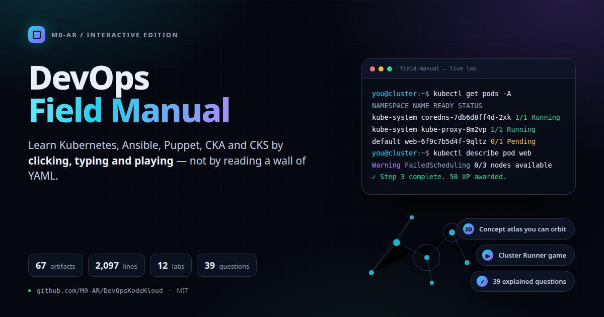
  </a>
</p>

<h1 align="center">DevOps Field Manual</h1>

<p align="center">
  <strong>Learn Kubernetes, Ansible, Puppet, CKA and CKS by clicking, typing and playing — not by reading a wall of YAML.</strong>
</p>

<p align="center">
  <a href="https://m0-ar.github.io/DevOpsKodeKloud/"></a>
  <a href="LICENSE"></a>
  <a href="https://github.com/M0-AR/DevOpsKodeKloud/releases/latest"></a>
  
  
  
</p>

<p align="center">
  <a href="https://m0-ar.github.io/DevOpsKodeKloud/"><strong>Open the live field manual</strong></a>
  &nbsp;·&nbsp;
  <a href="#-beginner-guide--read-this-and-you-are-a-professional">Start from zero</a>
  &nbsp;·&nbsp;
  <a href="docs/assets/video/devops-field-manual-demo.mp4">Watch the 42-second demo</a>
</p>

---

## Abstract

This repository is a complete, browser-native learning environment for DevOps
fundamentals, built from **67 real configuration artifacts** covering
Kubernetes, Ansible, Puppet, CKA and CKS. Instead of presenting files in a
flat list, it turns them into a live product: a searchable artifact explorer,
12 guided labs with command validation, 39 explained questions with spaced
repetition, a 3D concept atlas generated from the repository itself, a 3D game
that teaches cluster concepts, and a copy-ready command cheat sheet.

Everything runs as static files. There is no account, no backend, no tracking
and no external dependency at runtime. Progress is stored locally in the
browser. The same files can be read directly, served locally, published on
GitHub Pages, or run as a container image.

**In one sentence:** a hands-on DevOps textbook where every lesson is a real
file, every file is clickable, and every concept can be practised, quizzed and
seen in three dimensions.

> **New to all of this?** You do not need to know what Kubernetes is. Read the
> [beginner guide](#-beginner-guide--read-this-and-you-are-a-professional)
> first; it explains the words, the tools and a 30-minute first win.

---

## Why this exists

Most DevOps study material fails in one of two ways. It is either a folder of
copy-pasted manifests with no explanation, or a wall of theory with nothing to
run. Both leave the learner unable to connect a command to a real outcome.

This project closes that gap:

- Every artifact is **real, readable and linked** to the exact page that
  explains it.
- Every lab **validates what you type** and explains why the command works.
- Every question **comes back sooner when you get it wrong**, because
  retrieval practice beats re-reading.
- Every concept can be **seen spatially** in the atlas, and **practised under
  pressure** in the game.
- Every artifact carries an **honest modernization note** when it uses an API,
  image or pattern that is no longer current.

The result is a field manual you can use on a laptop with no cluster, no cloud
account and no sign-up.

---

## The live demo

<p align="center">
  <a href="https://m0-ar.github.io/DevOpsKodeKloud/">
    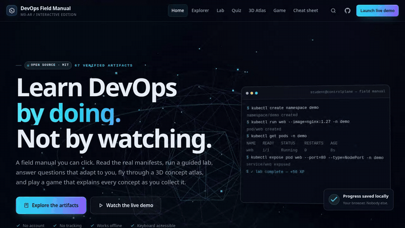
  </a>
</p>

The demo on the home page is not a video or a mockup. Each tab mounts the
actual page in an iframe: search the explorer, type in the lab, answer a
question, orbit the atlas, start the game. The poster image is only a
placeholder until you press **Launch interactive demo**.

<p align="center">
  <a href="docs/assets/video/devops-field-manual-demo.mp4"><strong>Watch the full walkthrough (42 seconds, MP4, 2.2 MB)</strong></a>
</p>

---

## What you get

| Surface | What it does | Best for |
| --- | --- | --- |
| [Artifact explorer](https://m0-ar.github.io/DevOpsKodeKloud/explorer.html) | Full-text search across 67 files, category/level filters, repository tree, syntax highlighting, copy, download and source links. | Finding a working example fast |
| [Guided labs](https://m0-ar.github.io/DevOpsKodeKloud/lab.html) | 12 labs with real command validation, recorded outputs, hints, restart and 50 XP per first completion. | Building muscle memory |
| [Question bank](https://m0-ar.github.io/DevOpsKodeKloud/quiz.html) | 39 explained questions with topic filters and spaced repetition. Wrong answers return sooner. | Testing what you actually know |
| [3D concept atlas](https://m0-ar.github.io/DevOpsKodeKloud/atlas.html) | A WebGL map of 73 nodes generated from the manifest. Orbit, zoom, search and click any node. | Seeing how topics connect |
| [Cluster Runner](https://m0-ar.github.io/DevOpsKodeKloud/game.html) | A 3D lane game: collect concept orbs, dodge failing pods, answer checkpoints, grow a neural map. | Revision disguised as play |
| [Cheat sheet](https://m0-ar.github.io/DevOpsKodeKloud/cheatsheet.html) | 69 copy-ready commands across Kubernetes, Ansible, Puppet and security, with notes on the traps. | Day-to-day reference |

### One profile, three ways to learn

Labs, quiz and game share a single local profile. Finish a lab, answer
questions and collect concepts, and the same XP total follows you across the
site. Nothing is uploaded. Clear the site data and you start fresh.

---

## Screens at a glance

<table>
  <tr>
    <td width="50%"><a href="https://m0-ar.github.io/DevOpsKodeKloud/explorer.html">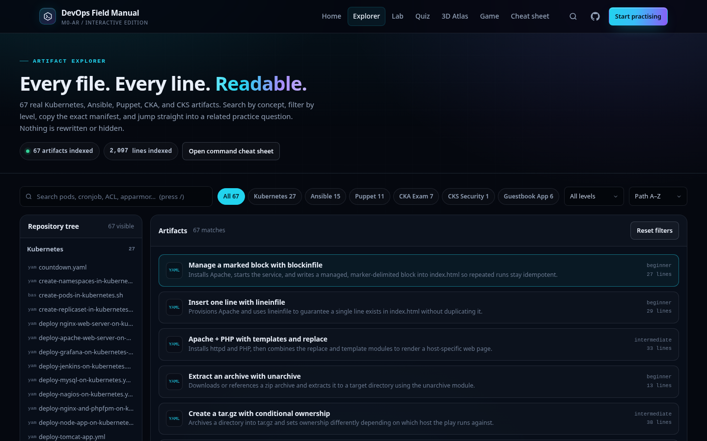</a><br><sub><strong>Explorer</strong> — search 67 artifacts and read the source.</sub></td>
    <td width="50%"><a href="https://m0-ar.github.io/DevOpsKodeKloud/lab.html">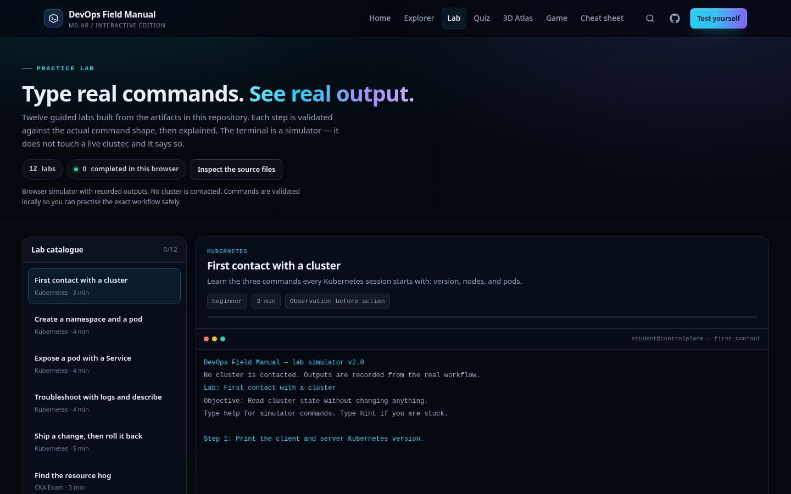</a><br><sub><strong>Lab</strong> — type a command, get validated and explained.</sub></td>
  </tr>
  <tr>
    <td width="50%"><a href="https://m0-ar.github.io/DevOpsKodeKloud/quiz.html">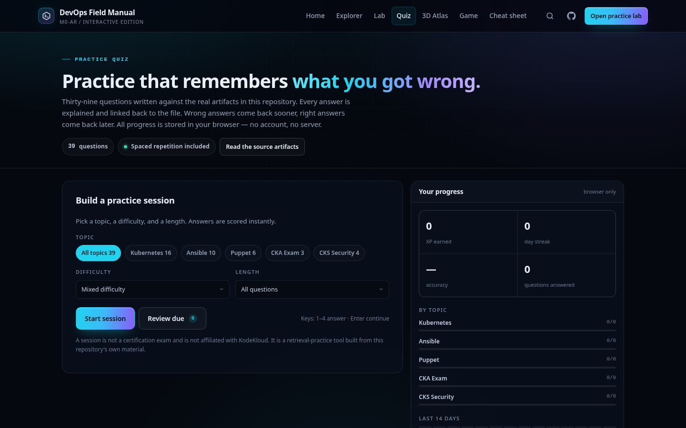</a><br><sub><strong>Quiz</strong> — every answer teaches the why.</sub></td>
    <td width="50%"><a href="https://m0-ar.github.io/DevOpsKodeKloud/atlas.html">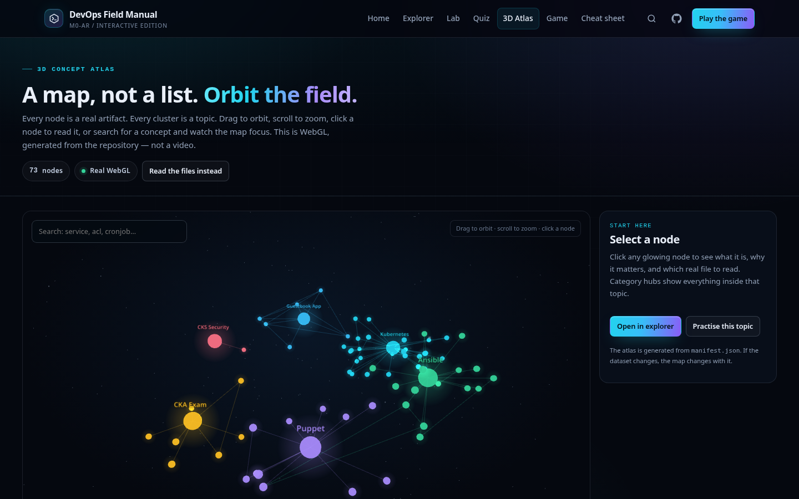</a><br><sub><strong>Atlas</strong> — orbit a map built from real files.</sub></td>
  </tr>
  <tr>
    <td width="50%"><a href="https://m0-ar.github.io/DevOpsKodeKloud/game.html">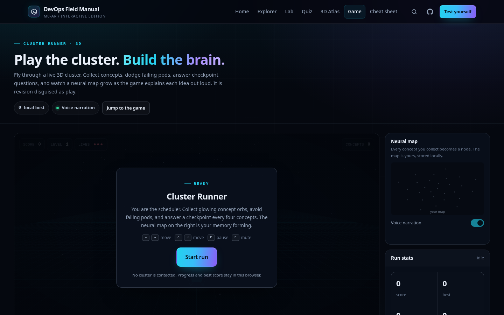</a><br><sub><strong>Cluster Runner</strong> — collect concepts, dodge failing pods.</sub></td>
    <td width="50%"><a href="https://m0-ar.github.io/DevOpsKodeKloud/cheatsheet.html">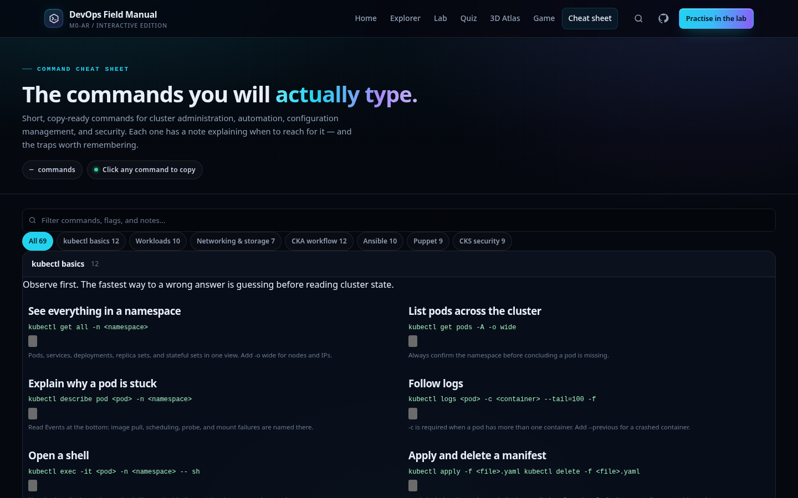</a><br><sub><strong>Cheat sheet</strong> — 69 commands, ready to copy.</sub></td>
  </tr>
</table>

---

## 🌱 Beginner guide — read this and you are a professional

This section assumes **zero prior knowledge**. You do not need a server, a
cloud account, or a Kubernetes cluster. You need a browser and about half an
hour. Read the words, try the buttons, and let the repetition do the rest.

### 1. What is DevOps, really?

DevOps is the habit of making software delivery **repeatable**. Imagine a
restaurant where every cook follows the same recipe card, the kitchen is
rebuilt the same way every night, and the manager can see immediately when an
order is stuck. DevOps is the recipe cards, the kitchen checklist and the
status board — for software.

Three ideas show up everywhere:

- **Infrastructure as code** — describe servers and applications in text files
  instead of clicking through screens.
- **Automation** — let a tool apply those files the same way every time.
- **Feedback** — measure what happened, then improve the recipe.

### 2. The tools in this repository

| Tool | Plain-language explanation | What it looks like here |
| --- | --- | --- |
| **Kubernetes** | A conductor for containers. You describe the desired state; Kubernetes keeps the orchestra playing. | `Kubernetes/` — 27 manifests |
| **Ansible** | A checklist that runs over SSH. It connects to machines and performs the listed tasks. | `ansible/` — 15 playbooks |
| **Puppet** | A rule enforcer. Agents continuously make a machine match the declared configuration. | `puppet/` — 11 manifests |
| **CKA** | A hands-on Kubernetes administrator exam. | 7 task-shaped exercises |
| **CKS** | A hands-on Kubernetes security exam. | 1 supply-chain and AppArmor challenge |

You do **not** need to learn all of them at once. Pick one path from
[learning paths](#learning-paths) and finish it before starting another.

### 3. What is a manifest?

A manifest is a recipe card written in YAML. It says what you want, not the
steps to make it. Here is a small Kubernetes example, annotated:

```yaml
apiVersion: v1                 # which API understands this object
kind: Pod                      # what you are creating: a pod
metadata:
  name: hello                  # the name inside the namespace
spec:
  containers:
    - name: web
      image: nginx:1.30-alpine # the program to run, pinned to a version
      ports:
        - containerPort: 80    # the port the container listens on
```

Read it like a sentence: *“In API version 1, create a Pod named hello, running
the NGINX 1.30 Alpine image, listening on port 80.”*

The other formats are variations on the same idea: an Ansible **playbook** is
a list of tasks for remote machines; a Puppet **manifest** is a list of
resources that must exist.

### 4. Your first 30 minutes

Do these in order. Each link opens the live site; nothing to install.

| Minute | What to do | Why |
| --- | --- | --- |
| 0–3 | [Open the home page](https://m0-ar.github.io/DevOpsKodeKloud/) and press **Launch interactive demo**. | See that this is a real product, not screenshots. |
| 3–8 | [Open the explorer](https://m0-ar.github.io/DevOpsKodeKloud/explorer.html), search for `nginx`, open the NGINX manifest. | Meet a real file and its explanation. |
| 8–16 | [Open the lab](https://m0-ar.github.io/DevOpsKodeKloud/lab.html?lab=first-contact) and finish **First contact with a cluster**. | Type three commands and get instant feedback. |
| 16–24 | [Open the quiz](https://m0-ar.github.io/DevOpsKodeKloud/quiz.html), choose **Beginner**, answer five questions. | Discover what you actually understood. |
| 24–28 | [Open the atlas](https://m0-ar.github.io/DevOpsKodeKloud/atlas.html), search `deployment`, click the node. | See how the topic connects to real files. |
| 28–30 | [Open Cluster Runner](https://m0-ar.github.io/DevOpsKodeKloud/game.html), start a run. | Reinforce the same concepts under light pressure. |

If a lab command feels mysterious, press **Show hint**. If an answer is wrong,
read the explanation — that is the lesson, not the score.

### 5. How to stay safe

- The labs are a **simulation**. They do not contact a cluster, a cloud or a
  remote server.
- Never apply an example manifest to a production cluster without reading it.
- Never commit real passwords, tokens or keys. The examples use placeholders
  on purpose.
- If you want a real cluster, use a local tool such as kind or minikube, and
  destroy it when you are done.
- Treat every `latest` image tag as a warning sign. Pin a version or a digest.

### 6. A seven-day starter plan

| Day | Focus | Time | Where |
| --- | --- | --- | --- |
| 1 | Words: pod, deployment, service, namespace | 25 min | Beginner guide + first lab |
| 2 | Your first YAML: read it, change it, explain it | 30 min | Explorer + quiz (beginner) |
| 3 | Services and networking | 30 min | Lab **Expose a pod with a Service** |
| 4 | Troubleshooting with logs and describe | 30 min | Lab **Troubleshoot with logs and describe** |
| 5 | Rollouts and rollbacks | 35 min | Lab **Ship a change, then roll it back** |
| 6 | Ansible or Puppet basics | 35 min | Path below + matching lab |
| 7 | Review only what you got wrong | 25 min | Quiz **Review mistakes** + atlas |

### 7. Words you will meet

| Word | Meaning in one line |
| --- | --- |
| **Container** | A packaged application with its dependencies, isolated from the host. |
| **Pod** | The smallest Kubernetes unit: one or more containers that share networking and storage. |
| **Deployment** | A controller that manages replicas and records rollout history. |
| **Service** | A stable network address in front of a changing set of pods. |
| **Namespace** | A named partition inside a cluster for organizing objects. |
| **Manifest** | A YAML or JSON file that declares desired state. |
| **kubectl** | The command-line client for Kubernetes. |
| **Playbook** | An Ansible file listing tasks to run on managed hosts. |
| **Module** | A reusable Ansible unit of work, such as `copy` or `service`. |
| **Catalog** | Puppet's compiled description of the desired configuration. |
| **Idempotent** | Running it twice produces the same result as running it once. |
| **Rollout** | Replacing pods with a new version gradually, with history to roll back. |

### 8. If you get stuck

1. Read the task again and identify the **object** and the **verb**.
2. Press **Show hint** in the lab; it names the missing piece without giving
   the whole answer away.
3. Open the related artifact from the quiz explanation or explorer.
4. Search the atlas for the concept and click the node to see the source file.
5. Ask in an issue with the lab name, the command you typed and what you
   expected. Do not paste secrets.

---

## Learning paths

| Path | Start | Then | Finish with |
| --- | --- | --- | --- |
| **Absolute beginner** | [Beginner guide](#-beginner-guide--read-this-and-you-are-a-professional) | Labs 1–3, beginner quiz | Atlas + one game run |
| **Kubernetes practitioner** | Explorer → Kubernetes | Labs 1–6, all Kubernetes questions | CKA mock exam files |
| **CKA candidate** | CKA mock exam directory | Labs **Resource triage**, **jsonpath and logs** | Timed quiz session |
| **CKS / security** | CKS challenge + audit notes | Lab **Scan before you deploy** | Security questions + cheat sheet |
| **Automation engineer** | Ansible path | Ansible labs + Puppet lab | Cheat sheet + audit notes |
| **Teacher / researcher** | Manifest and audit sections | Dataset files + licence | Build your own derivative |

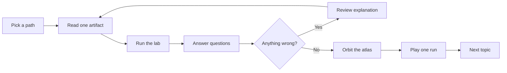

---

## Interactive labs

<p align="center">
  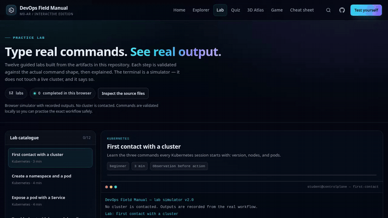
</p>

Twelve labs cover the first commands, namespaces, services, debugging,
rollouts, resource triage, Ansible, Puppet, security scanning, CKA jsonpath and
the full Guestbook stack. Each step accepts a family of valid commands, not one
brittle string, and returns a recorded output plus an explanation.

- **Validation:** every step uses one or more regular expressions.
- **Hints:** available without losing the step.
- **History:** arrow up and down recall previous commands.
- **Completion:** 50 XP the first time, replay is free.
- **Safety:** no cluster is contacted.

Start with [First contact with a cluster](https://m0-ar.github.io/DevOpsKodeKloud/lab.html?lab=first-contact).

---

## Spaced-repetition quiz

<p align="center">
  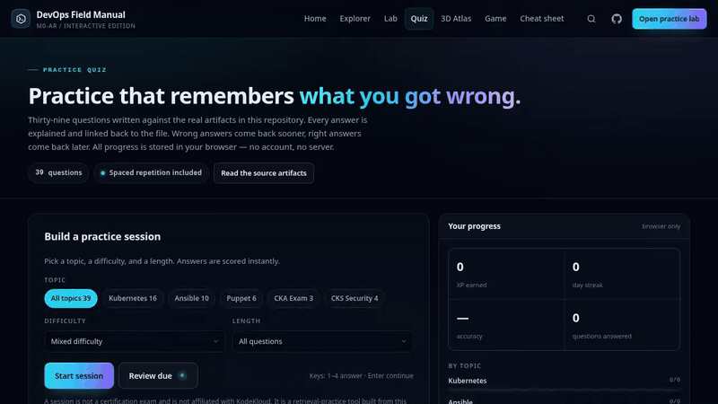
</p>

Thirty-nine questions across Kubernetes (16), Ansible (10), Puppet (6),
security (4) and exam technique (3). Each question has four options, one
correct answer and an explanation that says why the right answer is right and
why the tempting one is wrong.

- Beginner, intermediate and advanced filters.
- Topic filters and a configurable session length.
- Wrong answers return sooner; correct answers wait longer.
- A mistakes review and an end-of-session report.
- Every question links back to a real artifact.

Open the [question bank](https://m0-ar.github.io/DevOpsKodeKloud/quiz.html).

---

## 3D concept atlas

<p align="center">
  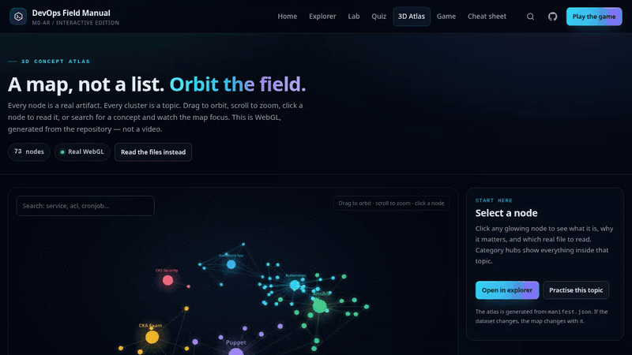
</p>

The atlas is generated from `docs/assets/data/manifest.json`, so it cannot
drift from the repository. Each of the 73 nodes is a real file or a category
hub.

- Drag to orbit, scroll to zoom, press `R` to reset.
- Search filters node opacity and focuses the first match.
- Click a node to read its title, description and source path.
- A DOM list mirrors the canvas for keyboard and screen-reader users.
- Animation pauses off-screen and respects `prefers-reduced-motion`.

Open the [3D concept atlas](https://m0-ar.github.io/DevOpsKodeKloud/atlas.html).

---

## Cluster Runner

<p align="center">
  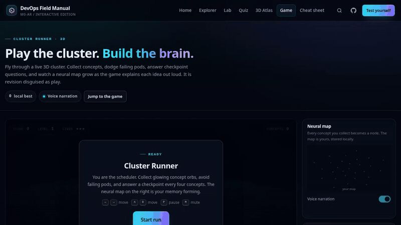
</p>

Cluster Runner turns revision into a short arcade run. You are the scheduler:
collect glowing concept orbs, avoid failing pods, and answer a checkpoint every
four concepts. Each collected concept becomes a node in a neural map that stays
in your local profile.

- Arrow keys or `A`/`D` to change lanes.
- `P` pauses, `M` mutes.
- Three lives; a correct checkpoint grants a shield.
- Voice narration explains each concept as you collect it.
- Touch controls are included and the canvas resizes to the viewport.

Play [Cluster Runner](https://m0-ar.github.io/DevOpsKodeKloud/game.html).

---

## Command cheat sheet

Sixty-nine commands across Kubernetes, Ansible, Puppet and security, each with
a note about the trap it avoids. Filter by text or section, then click any
command to copy it.

Open the [cheat sheet](https://m0-ar.github.io/DevOpsKodeKloud/cheatsheet.html).

---

## Repository map

```text
.
├── Kubernetes/                                 27 manifests and scripts
├── ansible/                                    15 playbooks
├── puppet/                                     11 manifests
├── Certified-Kubernetes-Administrator-(CKA)-Mock-Exam/
│   └── 10/                                     7 task-shaped exercises
├── CKS-Challenges/                             1 security challenge
├── deploy-guest-book-app-on-kubernetes/        6-file multi-tier app
├── docs/                                       the complete static site
│   ├── index.html                              landing page + live demo
│   ├── explorer.html                           artifact explorer
│   ├── lab.html                                guided labs
│   ├── quiz.html                               question bank
│   ├── atlas.html                              3D concept atlas
│   ├── game.html                               Cluster Runner
│   ├── cheatsheet.html                         command reference
│   ├── 404.html                                friendly not-found page
│   └── assets/
│       ├── css/site.css                        design system
│       ├── js/                                 page modules + bundled Three.js
│       ├── data/                               manifest, stats, labs, quiz
│       ├── img/                                screenshots and social preview
│       ├── gifs/                               animated walkthroughs
│       └── video/                              42-second demo
├── tools/
│   ├── site-meta.json                          human metadata for every file
│   ├── build-site-data.mjs                     regenerates the dataset
│   └── validate-site.mjs                       integrity checks
├── docker/nginx.conf                           production static server config
├── Dockerfile                                  multi-stage-ready container
├── .github/workflows/                          validate, release, container
├── CITATION.cff
├── CHANGELOG.md
├── CONTRIBUTING.md
├── CODE_OF_CONDUCT.md
├── SECURITY.md
└── LICENSE
```

The site is plain HTML, CSS and JavaScript. There is no bundler, no framework
and no runtime dependency beyond the locally bundled Three.js modules.

---

## Artifact inventory

| Directory | Files | What is inside | Good starting point |
| --- | ---: | --- | --- |
| `Kubernetes/` | 27 | Pods, Deployments, ReplicaSets, Jobs, CronJobs, Services, PV/PVC, ConfigMaps, init and sidecar containers, rollouts and troubleshooting. | `deploy nginx-web-server-on-kubernetes-cluster.yaml` |
| `ansible/` | 15 | Playbooks for files, users, packages, services, templates, facts, ACLs, archives, conditionals and links. | `basic-playbook.yml` |
| `puppet/` | 11 | Users, packages, services, files, symlinks, SSH keys, NTP, MariaDB and exact permissions. | `install-package.pp` |
| CKA mock exam | 7 | Memory triage, log filtering, environment updates, jsonpath, CronJob repair and probe fixes. | `06-check-cronjob-running-per-required-schedule.txt` |
| CKS challenges | 1 | Trivy scan, least-vulnerable image, AppArmor and NodePort deployment. | `scan_images_and_deploy.sh` |
| Guestbook app | 6 | PHP frontend, Redis master and replica Deployments, and their Services. | `front-end-service-redis-php.yml` |
| **Total** | **67** | **2,097 lines**, 57 KB of source. | [Explorer](https://m0-ar.github.io/DevOpsKodeKloud/explorer.html) |

Levels are balanced for progressive practice: 26 beginner, 28 intermediate
and 13 advanced artifacts.

Every file has a human title, a one-sentence description, tags and a level in
`tools/site-meta.json`. The explorer, atlas, search and quiz all read from that
metadata, so adding a file is a two-step change: add the file, then add its
metadata and rebuild.

---

## Honest audit: what is modern and what is not

Good teaching material must show its age. These artifacts were written over
several years, and some use APIs, images or patterns that have changed. The
site flags them in the explorer; the full list is below. Nothing here is
silently “fixed”, because the old form is often the lesson.

| Artifact | Note |
| --- | --- |
| `Kubernetes/kubernetes-cronjob.yml` | `batch/v1beta1` was removed in Kubernetes 1.25. Use `batch/v1`, pin the image, and fix the “Welocme” typo. |
| `Kubernetes/deploy-mysql-on-kubernetes.yaml` | MySQL 5.7 is end-of-life; Secret values are placeholders and need base64 encoding. Prefer a StatefulSet and an external secret store in production. |
| `Kubernetes/deploy-nginx-and-phpfpm-on-kubernetes.yaml` | `php:7.3-fpm` is end-of-life and `nginx:latest` is unpinned. Add probes and use supported images. |
| `Kubernetes/init-containers.yml` | `centos:latest` is unpinned and CentOS Linux is end-of-life. Use a maintained base image by digest. |
| `Kubernetes/replication-controller-in-kubernetes.yaml` | ReplicationController is legacy. New workloads should use a Deployment. |
| `Kubernetes/troubleshooting-fix-YAML-indentation.yml` | The Service selects `app: mysql_app` while the pods are labelled `app: mysql-app`, so no endpoints match. |
| `CKS-Challenges/scan_images_and_deploy.sh` | The generated manifest omits `apiVersion`/`kind`; AppArmor belongs in `securityContext.appArmorProfile` on modern Kubernetes. A Service alone does not enforce “only the middleware pod”; add a NetworkPolicy. |
| `deploy-guest-book-app-on-kubernetes/front-end-deploy-redis-php.yml` | The historic `gcr.io/google-samples` image should be verified and pinned by digest. |
| `ansible/create-users-and-groups.yaml` | `password_hash` without a stable salt is not idempotent. Use a fixed salt and keep secrets in Ansible Vault. |
| `puppet/setup-database.pp` | Credentials are in plain text. Move them to Hiera with eyaml or an external secret store, and pin the module version. |
| `puppet/setup-ssh-keys.pp` | The public key variable is empty, and the file duplicates `setup-ssh-keys-01.pp`. Keep one canonical, parameterized manifest. |
| `puppet/setup-ssh-keys-01.pp` | Duplicate of the above; consolidate to avoid drift. |

This audit is part of the product, not a disclaimer hidden at the bottom. The
explorer shows the note next to the source, and the quiz often asks about the
modern replacement.

---

## How it works

- **Source of truth:** the artifacts in the repository.
- **Generated data:** `tools/build-site-data.mjs` walks the six content
  directories, reads `tools/site-meta.json`, counts lines and writes
  `manifest.json` and `stats.json`. It is deterministic: run it twice and the
  output is identical.
- **Static pages:** each page is a small module in `docs/assets/js/`. There is
  no router and no server-side rendering.
- **Local-first:** `localStorage` key `dfm.progress.v1` holds XP, streak, lab
  completion, quiz history, spaced-repetition state, mistakes and game
  results.
- **No network calls at runtime:** the site loads only same-origin files.
- **Accessibility:** skip links, landmark regions, visible focus, ARIA tabs
  with arrow-key support, reduced-motion handling, a DOM fallback for the
  atlas and text alternatives for every image and canvas.
- **Performance:** no web fonts, no third-party scripts, lazy iframe mounting
  and animation that pauses when off-screen.

### Regenerate and verify

```bash
node tools/build-site-data.mjs   # rebuild manifest.json and stats.json
node tools/validate-site.mjs     # check files, labs, questions, pages and links
```

The validator checks that every artifact exists, every lab regex compiles,
every question has four options and a valid answer, every page has a title and
description, and every local `src`/`href` resolves.

---

## Run it locally

No build step is required to view the site.

```bash
git clone https://github.com/M0-AR/DevOpsKodeKloud.git
cd DevOpsKodeKloud
python3 -m http.server 8899 --directory docs
```

Then open <http://127.0.0.1:8899/>. Any static file server works; make sure
the server root is `docs/`.

To regenerate the data after editing an artifact:

```bash
node tools/build-site-data.mjs
node tools/validate-site.mjs
```

Node.js 22 or newer is recommended.

---

## Deploy

### GitHub Pages

The live site is published from the `master` branch, `/docs` folder. No action
is required after a push that changes `docs/`.

To deploy your own copy, fork the repository and set **Settings → Pages →
Build and deployment → Deploy from a branch → `master` / `/docs`**. The included
`404.html` handles unknown paths.

### Container

A multi-arch image is published to the GitHub Container Registry on every
release and on `master`:

```bash
docker run --rm -p 8080:80 ghcr.io/m0-ar/devopskodekloud:latest
```

Open <http://localhost:8080/>. The image serves the same static files behind
NGINX with gzip, cache headers, a Content Security Policy and a health check.

### Any static host

Upload the contents of `docs/` to Cloudflare Pages, Netlify, S3, an internal
web server or a USB stick. There is no backend to configure.

---

## Releases and packages

- **Releases:** <https://github.com/M0-AR/DevOpsKodeKloud/releases> — every
  tag includes a documentation archive and `SHA256SUMS.txt`, plus generated
  notes and the full changelog.
- **Container package:** `ghcr.io/m0-ar/devopskodekloud` — `latest` tracks
  `master`; version tags are immutable.
- **Source archive:** GitHub’s automatic `zip` and `tar.gz` for each release.

Verify a downloaded archive:

```bash
sha256sum -c SHA256SUMS.txt
```

---

## Quality bar

The project is checked on every push and pull request:

- Generated data is rebuilt and compared, so it cannot drift from the files.
- All 67 artifacts, 12 labs, 39 questions and 8 pages are validated.
- Every local link and required image, GIF and video is checked.
- Browser modules are syntax-checked.
- The container image is built for `linux/amd64` and `linux/arm64` with an
  SBOM and provenance attestation.

The interactive surfaces are exercised end to end: demo tab switching and
iframe mounting, lab completion and XP, quiz answer feedback and hidden
controls, atlas WebGL and search, game start/pause/resume, cheat-sheet filter
and empty state, explorer search and file opening, keyboard navigation and a
390 px mobile viewport.

---

## Who this is for

- **Complete beginners** who want a guided first hour without installing a
  cluster.
- **System administrators** moving from servers to Kubernetes and automation.
- **CKA and CKS candidates** who need task-shaped practice and honest notes.
- **Teachers and mentors** who want a free, remixable lab environment.
- **Researchers** interested in how static, local-first learning tools can be
  generated directly from a repository.

---

## FAQ

**Do I need Kubernetes, Docker or a cloud account?**
No. The labs are a browser simulation. If you want a real cluster later, use
kind, minikube or a managed cluster you control.

**Is this affiliated with KodeKloud, the CNCF or the vendors?**
No. It is an independent educational project. Names are used only to describe
the tools and exams.

**Can I use this in a course or workshop?**
Yes. The code and content are MIT licensed. Attribution is appreciated, and a
link back to the repository helps learners find updates.

**Why are some manifests outdated?**
They are teaching artifacts, and several intentionally show old APIs or broken
configuration. Every known issue is listed in the audit above and in the
explorer. Do not copy them to production without review.

**How do I reset my progress?**
Use the reset control in the quiz, or clear site data for the site in your
browser. The key is `dfm.progress.v1`.

**Does it track me?**
No. There is no analytics, no account and no external request at runtime.

**Why does the atlas need WebGL?**
It renders a real 3D scene. The page includes a text list fallback, and the
rest of the site works without WebGL.

**How can I contribute?**
Read [CONTRIBUTING.md](CONTRIBUTING.md), then open an issue or a pull request.
Small, focused changes are easiest to review.

---

## Citation

If you use this project in a course, workshop or research, cite it using the
metadata in [`CITATION.cff`](CITATION.cff):

```text
M0-AR. DevOps Field Manual, version 2.0.1. 2026.
https://github.com/M0-AR/DevOpsKodeKloud
```

The licence permits commercial and non-commercial reuse. A link back is
appreciated but not required.

---

## Contributing

Contributions are welcome: new artifacts, corrected manifests, better hints,
new questions, accessibility fixes and documentation improvements.

- Read [CONTRIBUTING.md](CONTRIBUTING.md) for the workflow and style.
- Follow the [Code of Conduct](CODE_OF_CONDUCT.md).
- Report security issues privately via [SECURITY.md](SECURITY.md).
- Use the issue templates for bugs and feature requests.

---

## Acknowledgements

- The Kubernetes, Ansible and Puppet communities for the tools and the
  documentation that make this material teachable.
- [Three.js](https://threejs.org/) (MIT) for the 3D atlas and the game,
  bundled locally so the site stays self-contained.
- [Contributor Covenant](https://www.contributor-covenant.org/) for the code
  of conduct.
- Every learner who reports a confusing step; those reports are how the labs
  get better.

---

## License

[MIT](LICENSE) © 2026 M0-AR.

You may use, modify, teach with and redistribute this project, including
commercially, provided the copyright notice and permission notice are
included. The software and examples are provided without warranty; you are
responsible for reviewing anything you apply to a real system.

---

<p align="center">
  <strong>Open the field manual. Pick one lab. Finish it.</strong><br>
  <a href="https://m0-ar.github.io/DevOpsKodeKloud/">m0-ar.github.io/DevOpsKodeKloud</a>
</p>
